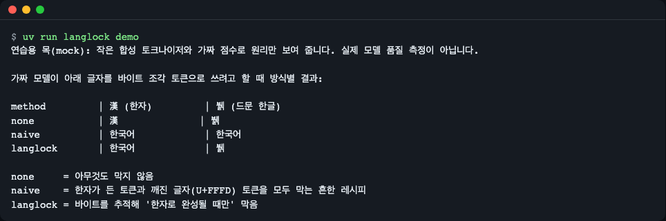
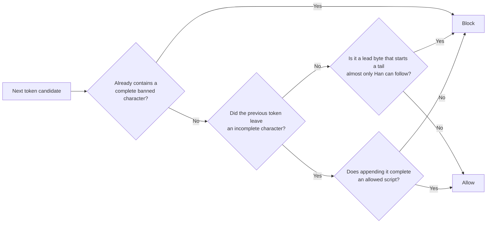
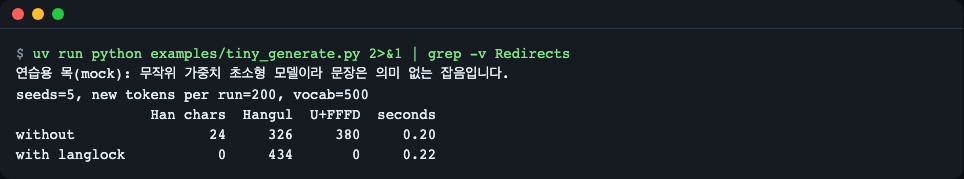
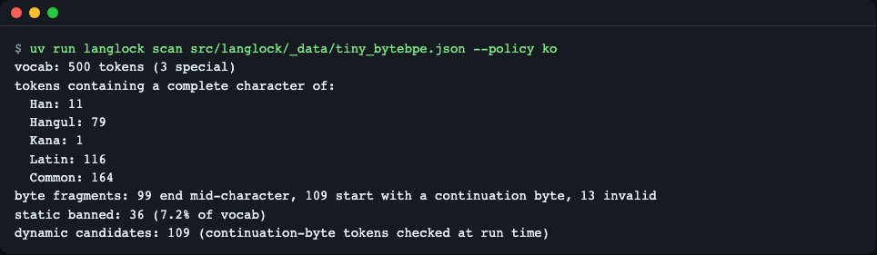
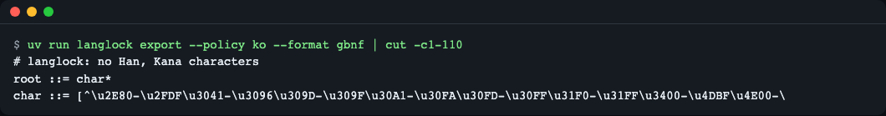
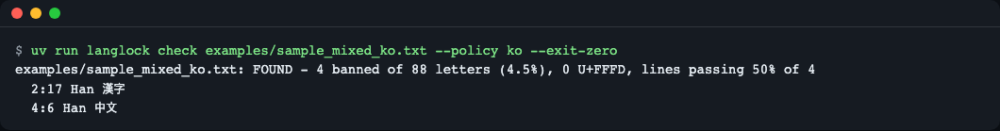

# langlock

[한국어](README.md) | **English**

langlock is a small Python library that keeps stray Chinese characters (or any other writing system you choose) out of LLM output *while the model is decoding*. It stops `漢字` or whole Chinese sentences from creeping into an answer you asked to be in Korean, at the moment the model picks a token. Writing "answer only in Korean" in the prompt is only a hint and does not remove the candidate tokens; langlock deletes them so they cannot be picked. It understands byte-level BPE vocabularies, so a half-written UTF-8 character is blocked only when it would finish as a banned script, and rare Hangul such as `뷁` survives. It has zero required dependencies and ships a Hugging Face `LogitsProcessor`, a llama-cpp-python processor, and exporters for llama.cpp `logit_bias`, GBNF and regex. Install from GitHub: `pip install "langlock[hf,numpy] @ git+https://github.com/LeeGyeongPil/langlock"` (a PyPI release is planned, not published yet). Limits: byte-level BPE tokenizers only (Qwen/DeepSeek style), Ollama is not supported, vLLM and mlx-lm adapters are planned (M2), SentencePiece byte-fallback is planned (M3).



*Figure 1. Output of `langlock demo`. With nothing blocked, a Han character (漢) appears; the common naive recipe blocks Han but also breaks the rare Hangul `뷁`; langlock blocks only Han and keeps `뷁`. (Practice mock mode: see below.)*

## Installation

Python 3.11 ~ 3.14 is required locally (the core tests were run on 3.11~3.14, the torch adapter tests on 3.12, and CI runs on Linux). The core has **zero required dependencies**.

```bash
# 1) Core only (standard library only: demo, scan, check, export, mask API)
pip install git+https://github.com/LeeGyeongPil/langlock

# 2) To serve with transformers or run examples/tiny_generate.py (installs torch and transformers too)
pip install "langlock[hf] @ git+https://github.com/LeeGyeongPil/langlock"

# 3) All extras the examples use (hf + numpy; the llama-cpp-python processor needs numpy)
pip install "langlock[hf,numpy] @ git+https://github.com/LeeGyeongPil/langlock"
```

It has not been published to PyPI yet. Until it is, `pip install langlock` does not work.

To download, develop and run from this repo (if you do not have uv: `curl -LsSf https://astral.sh/uv/install.sh | sh`):

```bash
git clone https://github.com/LeeGyeongPil/langlock
cd langlock
uv sync            # also installs torch, transformers, numpy for the tests (large wheels on Mac and Linux)

# or the light way (core features and core tests only, no torch):
uv sync --no-group ml
uv run --no-sync pytest -q       # 45 passed, 5 skipped, 2 deselected
uv run --no-sync langlock demo
```

After a light install, **always use `uv run --no-sync …`**. A plain `uv run` re-syncs the default group (ml) and downloads torch.

A minimal Linux container only needs `git`, `curl` and `uv` (or Python 3.11+ and pip) to run the core.

## Quick start

First, see the principle with no setup. This demo is a **practice mock**. It uses a small bundled synthetic tokenizer (500-token vocabulary) and fake scores to show the principle only; it does not measure real model quality. The only difference from real mode is "it is not a real model"; the mask code is the same code.

```bash
uv run langlock demo        # if installed: langlock demo
```

```text
연습용 목(mock): 작은 합성 토크나이저와 가짜 점수로 원리만 보여 줍니다. 실제 모델 품질 측정이 아닙니다.

가짜 모델이 아래 글자를 바이트 조각 토큰으로 쓰려고 할 때 방식별 결과:

method         | 漢 (한자)         | 뷁 (드문 한글)
none           | 漢              | 뷁
naive          | 한국어            | 한국어
langlock       | 한국어            | 뷁

none     = 아무것도 막지 않음
naive    = 한자가 든 토큰과 깨진 글자(U+FFFD) 토큰을 모두 막는 흔한 레시피
langlock = 바이트를 추적해 '한자로 완성될 때만' 막음
```

(Column alignment may be slightly off depending on the terminal because of CJK character widths. The output is Korean; in English: "practice mock: shows only the principle with a small synthetic tokenizer and fake scores, not a real quality measurement"; the table shows per-method results when the fake model tries to write each character as byte-fragment tokens, where 한자 = Han, 드문 한글 = rare Hangul; `none` blocks nothing, `naive` is the common recipe that blocks every token containing a Han character and every broken-character (U+FFFD) token, and `langlock` tracks bytes and blocks only when a character would finish as Han.)

Next is the smallest example that asks the library directly (`examples/quickstart.py`). It checks "may I write the next byte?" one character at a time.

```python
from langlock import detect
from langlock.demo import bundled_vocab

vocab = bundled_vocab()           # the small bundled byte-level BPE tokenizer
mask = vocab.script_mask("ko")    # bans Han and Kana

for char in "한뷁漢":
    state = mask.new_state()      # one state per generated sentence
    for i, byte in enumerate(char.encode(), start=1):
        token = vocab.token_for_bytes(bytes([byte]))
        if mask.decide(state).is_banned(token):
            print(f"{char} byte {i}/3 {byte:#04x}: BLOCKED")
            break
        print(f"{char} byte {i}/3 {byte:#04x}: allowed")
        state.feed(token)

print(detect("한국어 문장에 漢字가 끼었다", "ko").spans)
```

```text
한 byte 1/3 0xed: allowed
한 byte 2/3 0x95: allowed
한 byte 3/3 0x9c: allowed
뷁 byte 1/3 0xeb: allowed
뷁 byte 2/3 0xb7: allowed
뷁 byte 3/3 0x81: allowed
漢 byte 1/3 0xe6: BLOCKED
((1, 9, 'Han', '漢字'),)
```

`한` and `뷁` pass on all three bytes, while `漢` is blocked at its first byte (`0xe6`). The last line is the result of `detect()`, which finds banned characters in already finished text, as `(line, column, script, characters)`. (The sample sentence "한국어 문장에 漢字가 끼었다" means "Han characters slipped into a Korean sentence".)

## Core concepts

**1. Logits and masking.** A language model scores the whole vocabulary (the logits) for each next token and picks one. If you set a token's score to `-inf` just before the pick (hard), it can never be chosen; if you only lower it a little (soft), it is chosen less often. `logit_bias` is the way a server API lets you write this score adjustment into the request.

**2. Byte-level BPE and "a character typed with three keys".** Qwen and DeepSeek families build tokens from UTF-8 **bytes**, not characters. Hangul and Han characters take 3 bytes, so a frequent character is one token, but a rare character (`뷁`, for example bytes `EB B7 81`) comes out split into several tokens. It is like having to press a key three times to type one character. Looking at the first key alone, you sometimes cannot tell whether the character is Hangul or Han.

**3. That is why the naive recipe breaks.** The common method of "block every token that contains a Han character and every `�` token" also blocks fragment tokens (incomplete pieces such as the first two bytes of `뷁`) because they render as `�`. As a result `뷁` is turned into a different character like `한국어` or gets corrupted (the `naive` row above). langlock **remembers the incomplete tail as state** and blocks only when the character that could follow would be Han (a banned script).



- Tokens that contain a complete Han or Kana character are always blocked (static ban).
- A "continuation byte" token that suddenly appears while there is no incomplete tail is broken UTF-8, so it is blocked.
- When there is a tail, only continuation-byte tokens that complete an allowed script when appended are left open.
- If 90% (`tail_ban_ratio`) or more of the characters reachable from a tail belong to a banned script, starting that tail is blocked outright (the dead-end rule).
- If no candidate is left, only special tokens (such as end of sentence) are opened so generation can stop.

## API

The public API is imported from `langlock` (adapters and exporters live in submodules).

| Name | What it does | Main arguments | Returns |
|---|---|---|---|
| `load_vocab(source)` | Reads a tokenizer.json path, a JSON dict or a transformers tokenizer and recovers each token's original bytes | `source`: path (`str`/`Path`), dict or tokenizer object | `VocabIndex`. `UnsupportedTokenizerError` if it is not byte-level BPE |
| `VocabIndex` | Vocabulary index | `.size`, `.token_bytes(id)`, `.token_for_bytes(bytes)`, `.is_special(id)`, `.stats(policy)`, `.script_mask(policy)` | `ScanStats` etc. |
| `Policy` | What to block | `ban_scripts`, `mode="hard"\|"soft"`, `bias=-8.0`, `exempt_code_blocks=False`, `exempt_think=False`, `tail_ban_ratio=0.9`; `Policy.preset(name, **overrides)` | Immutable dataclass. `PolicyError` for bad values, `UnknownPresetError` for an unknown preset name |
| `ScriptMask(vocab, policy)` | Engine-independent core (usually created with `vocab.script_mask(policy)`) | `.new_state()`, `.decide(state)`, `.static_ids()` | `RowState`, `Decision` |
| `RowState` | Progress state of one sentence (incomplete tail, exempt ranges) | `.feed(token_id)`, `.sync(generated_ids)`, `.reset()` | - |
| `Decision` | What to block for the next token | `.is_banned(token_id)`, `.exempt`, `.fallback` | `bool` etc. |
| `detect(text, policy="ko")` | Finds banned characters in finished text | `text`, `policy` | `DetectReport` (`banned_chars`, `letters`, `ratio`, `spans`, `replacement_chars`, `line_pass_rate`, `ok`) |
| `langlock.hf.LanglockLogitsProcessor(vocab, policy, prompt_len=None)` | Processor for transformers `generate()` (`langlock[hf]`) | `vocab`, `policy` (a name such as "ko" works), `prompt_len` | `LogitsProcessor` |
| `langlock.llamacpp.make_logits_processor(vocab, policy="ko", prompt_len=0)` | numpy processor for llama-cpp-python (`langlock[numpy]`) | same as above; `prompt_len` is the number of prompt tokens | `f(input_ids, scores) -> scores` |
| `langlock.export.to_logit_bias(vocab, policy, style="llamacpp", bias=None)` | Exports the list of always-blocked tokens | `style`: `"llamacpp"` (`[[id, false], ...]`) or `"openai"` (`{"id": bias}`, -100 to 100) | `list` or `dict` |
| `langlock.export.to_gbnf(policy)` / `to_regex(policy)` | The same policy as a GBNF grammar or a regex | `policy` (hard mode only) | `str` |
| Exceptions | `LanglockError` ⊃ `UnsupportedTokenizerError`, `UnknownPresetError`, `PolicyError` | | |

Presets: `ko` (bans Han and Kana), `en` (bans Han, Kana, Hangul and Cyrillic), `ru` (bans Han, Kana and Hangul).

Command line (`langlock --version` → `langlock 0.1.3`):

| Command | What it does |
|---|---|
| `langlock demo` | Practice mock demo |
| `langlock scan <tokenizer.json> [--policy ko] [--json]` | Script distribution of the vocabulary, static ban count, dynamic candidate count |
| `langlock check <파일...> [--policy ko] [--json] [--exit-zero]` | Reports positions and ratio of banned characters in text. Exit code 1 if any are found; with `--exit-zero` it is always 0 |
| `langlock export [<tokenizer.json>] --format logit-bias\|openai-bias\|gbnf\|regex [--policy ko]` | Exports the policy (the logit-bias formats need a tokenizer) |

The policy options (`--mode hard\|soft`, `--bias`, `--exempt-code-blocks`, `--exempt-think`) are shared by `scan`, `check` and `export`.

## Usage examples

The file paths below (`examples/`, `src/`) assume you have cloned the repo.

### 1. Plugging into transformers `generate()`

```python
from transformers import LogitsProcessorList
from langlock import load_vocab
from langlock.hf import LanglockLogitsProcessor

vocab = load_vocab(tokenizer)                       # or a "tokenizer.json" path
processor = LanglockLogitsProcessor(vocab, "ko")    # create a new one for every generate() call
output = model.generate(**inputs, logits_processor=LogitsProcessorList([processor]))
```

You can put it in the same list as other processors (such as an allowed-token set). Each processor only lowers scores, so the constraints stack and all of them hold. The snippet above only shows the shape; the example that actually runs the same call is `examples/tiny_generate.py`.

**Practice mock**: a tiny model with random weights (`Qwen2ForCausalLM`, no download) runs a real `generate()` sampling 5 seeds × 200 tokens, comparing without and with the processor. The sentences are meaningless noise, and this is **a demonstration that "plugging it in brings it to 0", not a quality comparison**.

```bash
uv run python examples/tiny_generate.py
```

```text
연습용 목(mock): 무작위 가중치 초소형 모델이라 문장은 의미 없는 잡음입니다.
seeds=5, new tokens per run=200, vocab=500
                Han chars  Hangul  U+FFFD  seconds
without                24     326     380     0.21
with langlock           0     434       0     0.23
```

(The first line reads: "practice mock: it is a tiny model with random weights, so the sentences are meaningless noise.")



*Figure 2. With the processor plugged in, Han characters go 24→0 and broken characters (U+FFFD) 380→0. Timings vary by environment.*

### 2. llama-cpp-python

```python
from llama_cpp import Llama, LogitsProcessorList
from langlock import load_vocab
from langlock.llamacpp import make_logits_processor

vocab = load_vocab("tokenizer.json")
llm = Llama(model_path="model.gguf")
prompt_tokens = llm.tokenize(prompt.encode())
f = make_logits_processor(vocab, "ko", prompt_len=len(prompt_tokens))   # create a new one for every request
llm.create_completion(prompt, logits_processor=LogitsProcessorList([f]))
```

**This repo did not install and run this snippet with llama-cpp-python.** That the numpy processor blocks the same positions as the core mask was confirmed by tests (`tests/test_llamacpp.py`). The tokenizer JSON must have the same vocabulary as the model.

### 3. llama.cpp server: exporting a static ban list and a grammar

To get a real model tokenizer (Qwen2.5 example, using curl instead of Python):

```bash
curl -L -o tokenizer.json https://huggingface.co/Qwen/Qwen2.5-0.5B-Instruct/resolve/main/tokenizer.json
uv run langlock scan tokenizer.json --policy ko
```

Result with the small bundled tokenizer (`src/langlock/_data/tiny_bytebpe.json`) (actual run):

```bash
uv run langlock scan src/langlock/_data/tiny_bytebpe.json --policy ko
```

```text
vocab: 500 tokens (3 special)
tokens containing a complete character of:
  Han: 11
  Hangul: 79
  Kana: 1
  Latin: 116
  Common: 164
byte fragments: 99 end mid-character, 109 start with a continuation byte, 13 invalid
static banned: 36 (7.2% of vocab)
dynamic candidates: 109 (continuation-byte tokens checked at run time)
```



*Figure 3. `scan` on the bundled tokenizer. "static banned" are tokens that are always blocked; "dynamic candidates" are continuation-byte tokens judged at run time from the state.*

The same command on the real Qwen2.5-0.5B-Instruct `tokenizer.json` (1.1 seconds, Mac CPU):

```text
vocab: 151665 tokens (22 special)
tokens containing a complete character of:
  Han: 26097
  Hangul: 3577
  Kana: 2142
  ...
byte fragments: 1255 end mid-character, 180 start with a continuation byte, 13 invalid
static banned: 28273 (18.6% of vocab)
dynamic candidates: 180 (continuation-byte tokens checked at run time)
```

(The middle script lines are omitted. With only 180 dynamic candidates, the stateful check is light.)

Exporting the static list and the grammar:

```bash
uv run langlock export tokenizer.json --policy ko --format logit-bias > bias.json   # [[id, false], ...]
uv run langlock export --policy ko --format gbnf > ko.gbnf
```

`gbnf` output (actual run):

```text
# langlock: no Han, Kana characters
root ::= char*
char ::= [^\u2E80-\u2FDF\u3041-\u3096\u309D-\u309F\u30A1-\u30FA\u30FD-\u30FF\u31F0-\u31FF\u3400-\u4DBF\u4E00-\u9FFF\uF900-\uFAFF\uFF66-\uFF9F\U0001B000-\U0001B16F\U00020000-\U0002A6DF\U0002A700-\U0002EBEF\U0002F800-\U0002FA1F\U00030000-\U000323AF]
```



*Figure 4. `export --format gbnf` (the long line is cut to fit the screen width).*

Request example (the shape of putting `logit_bias` into the llama.cpp server's `/completion`, **not verified against a real server**):

```json
{ "prompt": "...", "logit_bias": [[127, false], [128, false]] }
```

**The static approach is weaker than the stateful processor.** A static list cannot contain "continuation-byte" tokens (including them would also block the middle bytes of Hangul), so it cannot stop cases where a Han character comes out split into byte fragments. For the same reason, the code-block and `<think>` exemptions and the stateful decisions of soft mode cannot be expressed by a static list. GBNF and regex are exact per character, but because there is only one grammar per request, they are hard to combine with other grammars. Putting the generated GBNF into a real llama.cpp was not done in this repo.

### 4. Checking output (operations and CI)

```bash
uv run langlock check examples/sample_mixed_ko.txt --policy ko --exit-zero
```

```text
examples/sample_mixed_ko.txt: FOUND - 4 banned of 88 letters (4.5%), 0 U+FFFD, lines passing 50% of 4
  2:17 Han 漢字
  4:6 Han 中文
```



*Figure 5. Positions are shown as `line:column script characters`.*

Without `--exit-zero`, the exit code is 1 when banned characters are present, so it can be used as a CI gate (exit code 1 was confirmed for the file above). If the text has no banned characters, the exit code is 0. You can also get machine-readable results with `--json`.

### 5. Soft mode and exemptions

```python
from langlock import Policy

policy = Policy.preset("ko", mode="soft", bias=-6.0, exempt_code_blocks=True, exempt_think=True)
```

Code blocks (inside \`\`\`) and `<think>…</think>` ranges are left alone, and Han characters in the body only get a lower probability. The tests (`tests/test_policy.py`, `tests/test_mask.py`) confirm that soft mode adds exactly `bias` to the score of banned tokens and leaves other tokens unchanged.

## Limitations

- **Ollama is not supported.** It has no logits-processor extension point or `logit_bias`, so there is nothing to plug into. Only output measurement (`langlock check`) can be used. Official docs checked on 2026-11-10: <https://raw.githubusercontent.com/ollama/ollama/main/docs/api/openai-compatibility.mdx>
- **The only supported tokenizers are byte-level BPE (ByteLevel)** (Qwen and DeepSeek families). WordPiece and SentencePiece byte-fallback (Gemma, Llama2 families, etc.) are rejected with `UnsupportedTokenizerError`. SentencePiece support is planned for the third milestone (M3).
- **There is no vLLM processor or mlx-lm adapter yet** (planned for M2). For vLLM, the only route offered is extracting a regex with `langlock export --format regex`, which has not been verified against a real server.
- **Exporting GBNF and `logit_bias` was not verified with a real llama.cpp.** The tests cover only that the exported set equals the static ban set and that the regex accepts Korean, English and emoji while rejecting Han characters.
- **Real model quality was not measured.** `examples/real_hf_qwen.py` is provided so you can run it yourself, but this repo does not publish its results. Blocking hard can make the model pick awkward substitute tokens, which is why soft mode is also provided.
- Beam search (`num_beams > 1`) is outside the guaranteed scope (row order changes and the state is rebuilt).
- There is no Japanese policy (Han characters and Japanese kanji are hard to tell apart). There is also no policy yet that allows Han characters written in parentheses next to Korean words.
- The core tests were run on Python 3.11, 3.12, 3.13 and 3.14 (45 passed, 5 skipped). The torch adapter tests were run only on 3.12.

## When to use it

- **Use it when**: you serve a Qwen or DeepSeek family open model yourself through transformers, llama-cpp-python or a llama.cpp server and want to block Han characters creeping into Korean (or English or Russian) answers at the decoding stage; or you need a standalone processor that can be used together with grammar constraints or allowed-token processors.
- **Use something else when**: to force the whole output into a fixed grammar or JSON schema → [llama.cpp grammars (GBNF)](https://github.com/ggml-org/llama.cpp/blob/master/grammars/README.md); to permanently reduce it per model by editing the weights themselves → [Smoothie-Qwen](https://github.com/dnotitia/smoothie-qwen). The research [Language Confusion Gate](https://arxiv.org/abs/2510.17555) (checked 2026-11-10), which reduces language confusion with a gate at decoding time, requires training an extra gate, and we found no package you can install and use right away. This library works without training, applied directly on the serving side. If you serve with Ollama, this library cannot be used.

## Troubleshooting

| Symptom | Cause | Fix |
|---|---|---|
| `UnsupportedTokenizerError` | A tokenizer that is not byte-level BPE (WordPiece, SentencePiece, etc.) | Check that it is in the supported range (Qwen and DeepSeek families). SentencePiece is not supported yet |
| `ImportError: ... needs numpy` | numpy is missing for the llama-cpp-python processor | `pip install "langlock[numpy]"` |
| `import langlock.hf` fails | torch and transformers are not installed | `pip install "langlock[hf]"` |
| `pip install langlock` gives "No matching distribution" | Not uploaded to PyPI yet | Use the `git+https` command in the Installation section above |
| The columns of the `demo` table are misaligned in a Mac terminal | Han and Hangul character widths differ by terminal | The content is the same. Just check the table values |
| `check` exits with code 1 | It means banned characters were found (not an error) | For demos or reports, use `--exit-zero` |
| Closing a long-output command early with `\| head` or `\| head -c 100` gives exit code 141 (e.g. `langlock check 큰파일.txt \| head -n 1`) | The receiving end closed first and it quietly ended (128 + SIGPIPE). There is no error message. `echo $?` at the end of the pipe is `head`'s 0, so in bash use `${PIPESTATUS[0]}`, or `$?` after `set -o pipefail` (in zsh, `$pipestatus[1]`). The logit-bias output of `export` is a single line, so `\| head` alone does not close it; it takes `head -c N` | Normal behavior. If you need the whole output, save it to a file |
| `langlock: error: OpenAI logit_bias values must be between -100 and 100, got -200.0` (exit code 2) | In `export --format openai-bias --mode soft`, `--bias` is out of range (e.g. -200) | Use a value between -100 and 100. (Exporting without `--mode` defaults to -100) |
| `uv run …` installs torch after `uv sync --no-group ml` | `uv run` re-syncs the default group (ml) | `uv run --no-sync …` |
| Two-line warning `Redirects are currently not supported in MacOs` | A notice torch prints on Mac | Safe to ignore |
| Odd results after reusing a processor | A processor remembers per-sentence state | Create a new one for every `generate()` / `create_completion()` call |
| Some Han characters remain (when using a static `logit_bias`) | A static list cannot block byte fragments | Use the stateful processor (`LanglockLogitsProcessor` etc.) |

## Versioning and compatibility

- Follows Semantic Versioning (SemVer). During 0.x the API may change in minor versions, and changes are recorded in [CHANGELOG.md](CHANGELOG.md). Currently 0.1.3.
- Python `>=3.11,<3.15`. No required dependencies. Optional: `hf` (torch>=2.6, transformers>=5.0), `numpy` (numpy>=1.26).
- Roadmap: M2 vLLM and mlx-lm adapters, M3 SentencePiece byte-fallback.

## Development and contributing

```bash
uv sync
uv run pytest -q                      # offline tests (56 passed; the 2 real tokenizer/model tests are excluded by default)
uv run python scripts/make_tiny_tokenizer.py   # regenerate the bundled tokenizer (only when needed)
```

The real tokenizer/model tests are excluded by default. Turn them on with an environment variable (see `.env.example`).

```bash
LANGLOCK_TOKENIZER_JSON=./tokenizer.json uv run pytest -q -m real
```

## Further reading

- Byte-level BPE and UTF-8: <https://en.wikipedia.org/wiki/Byte_pair_encoding>, <https://en.wikipedia.org/wiki/UTF-8>
- transformers logits processors: <https://huggingface.co/docs/transformers/main_classes/text_generation#transformers.LogitsProcessor>
- llama.cpp server (`logit_bias` and grammars): <https://github.com/ggml-org/llama.cpp/tree/master/tools/server>
- A report of the problem (Chinese mixed into Qwen-family responses): <https://huggingface.co/Qwen/QwQ-32B-Preview/discussions/16> (checked 2026-11-10)

## License

MIT. See [LICENSE](LICENSE).
