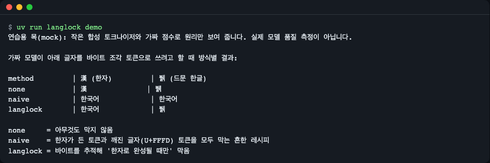
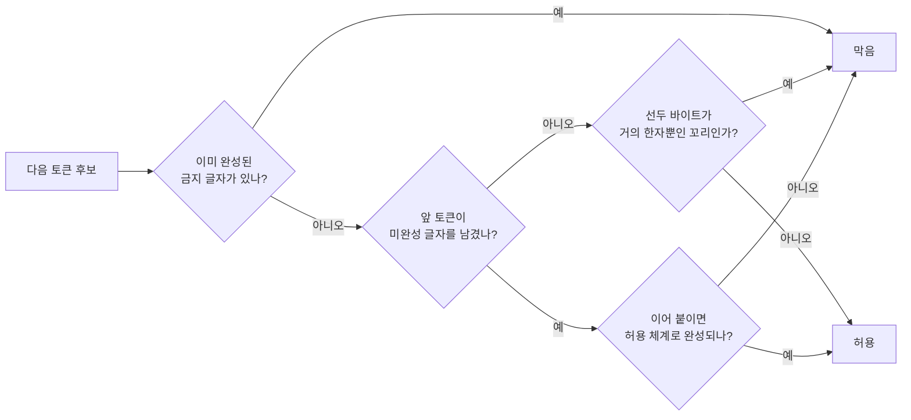
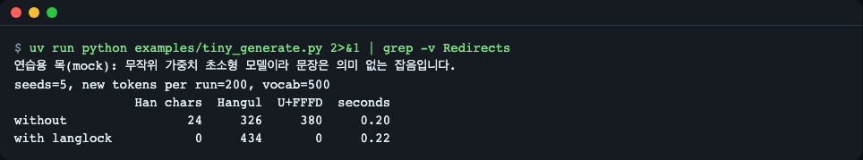
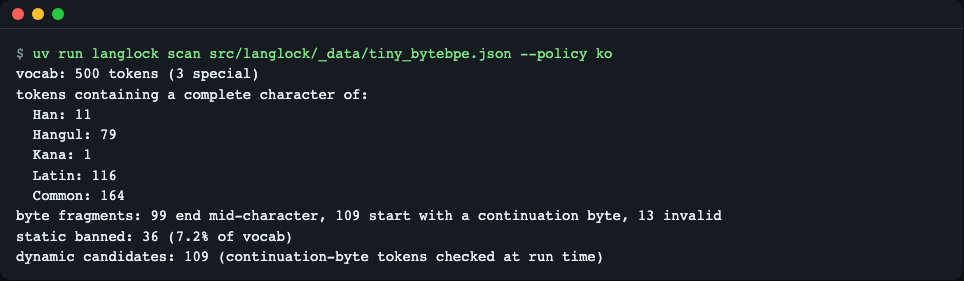
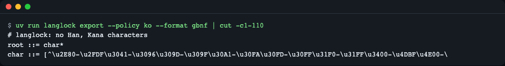
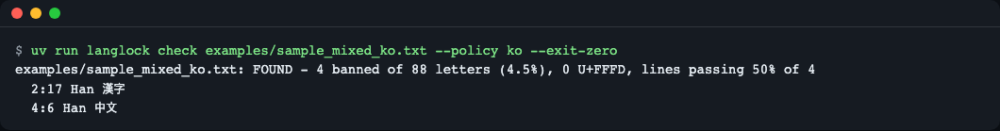

# langlock

> **English summary** — langlock is a small Python library that keeps stray Chinese characters (or any other writing system you choose) out of LLM output *while the model is decoding*. It understands byte-level BPE vocabularies, so a half-written UTF-8 character is blocked only when it would finish as a banned script, and rare Hangul such as `뷁` survives. It has zero required dependencies and ships a Hugging Face `LogitsProcessor`, a llama-cpp-python processor, and exporters for llama.cpp `logit_bias`, GBNF and regex. Install from GitHub: `pip install "langlock[hf,numpy] @ git+https://github.com/LeeGyeongPil/langlock"` (a PyPI release is planned, not published yet). Limits: byte-level BPE tokenizers only (Qwen/DeepSeek style), Ollama is not supported, vLLM and mlx-lm adapters are planned (M2), SentencePiece byte-fallback is planned (M3).

한국어로 답하라고 했는데 중간에 `漢字` 나 중국어 문장이 끼어드는 일을, **모델이 글자를 고르는 그 순간**에 막아 주는 라이브러리입니다. 후처리로 한자를 지우거나 다시 생성하는 일을 줄여 줍니다.

프롬프트에 "한국어로만 답하라"고 적어도 안 막히는 이유는, 지시는 모델이 점수를 매길 때 참고하는 힌트일 뿐 후보 토큰 자체를 없애지 못하기 때문입니다. 한자 토큰은 여전히 후보에 남아 있고 확률이 높은 순간에 뽑힙니다. 이 라이브러리는 후보를 직접 지워서 "뽑힐 수 없게" 만듭니다.



*그림 1. `langlock demo` 실행 화면. 아무것도 안 막으면 한자(漢)가 나오고, 흔한 단순 레시피는 한자를 막지만 드문 한글 `뷁` 까지 깨뜨리고, langlock 은 한자만 막고 `뷁` 은 살립니다. (연습용 목 모드: 아래 설명 참고)*

## 설치

로컬 Python 3.11 ~ 3.14 가 필요합니다(이 레포의 시험은 3.12 에서만 실행해 봤습니다). 핵심은 **필수 의존성이 0개**입니다.

```bash
# 1) 핵심만 (표준 라이브러리만 사용: demo, scan, check, export, 마스크 API)
pip install git+https://github.com/LeeGyeongPil/langlock

# 2) transformers 로 서빙하거나 examples/tiny_generate.py 를 돌릴 때 (torch, transformers 가 같이 설치됨)
pip install "langlock[hf] @ git+https://github.com/LeeGyeongPil/langlock"

# 3) 예제가 쓰는 extras 전부 (hf + numpy; llama-cpp-python 처리기는 numpy 가 필요)
pip install "langlock[hf,numpy] @ git+https://github.com/LeeGyeongPil/langlock"
```

PyPI 게시는 아직 하지 않았습니다. 게시되기 전에는 `pip install langlock` 이 동작하지 않습니다.

이 레포를 내려받아 개발·실행하려면(uv 가 없으면 `curl -LsSf https://astral.sh/uv/install.sh | sh`):

```bash
git clone https://github.com/LeeGyeongPil/langlock
cd langlock
uv sync            # 시험용 torch·transformers·numpy 까지 설치 (맥·리눅스 휠이 큼)

# 또는 가볍게 (torch 없이 핵심 기능과 핵심 시험만):
uv sync --no-group ml
uv run --no-sync pytest -q       # 42 passed, 5 skipped, 2 deselected
uv run --no-sync langlock demo
```

가볍게 설치한 뒤에는 **반드시 `uv run --no-sync …`** 를 쓰세요. 그냥 `uv run` 은 기본 그룹(ml)을 다시 설치해 torch 까지 받습니다.

최소 리눅스 컨테이너에서는 `git`, `curl`, `uv`(또는 Python 3.11+ 와 pip)만 있으면 핵심을 돌릴 수 있습니다.

## 빠르게 시작하기

먼저 아무 준비 없이 원리를 봅니다. 이 시연은 **연습용 목(mock)** 입니다. 동봉한 작은 합성 토크나이저(어휘 500개)와 가짜 점수로 원리만 보여 주며, 실제 모델의 품질을 재는 것이 아닙니다. 실제 모드와 다른 점은 "진짜 모델이 아니라는 것"뿐이고, 마스크 코드는 실제와 같은 코드입니다.

```bash
uv run langlock demo        # 설치본이면: langlock demo
```

```text
연습용 목(mock): 작은 합성 토크나이저와 가짜 점수로 원리만 보여 줍니다. 실제 모델 품질 측정이 아닙니다.

가짜 모델이 아래 글자를 바이트 조각 토큰으로 쓰려고 할 때 방식별 결과:

method         | 漢 (한자)         | 뷁 (드문 한글)
none           | 漢              | 뷁
naive          | 한국어            | 한국어
langlock       | 한국어            | 뷁

none     = 아무것도 막지 않음
naive    = 한자가 든 토큰과 깨진 글자(U+FFFD) 토큰을 모두 막는 흔한 레시피
langlock = 바이트를 추적해 '한자로 완성될 때만' 막음
```

(CJK 문자 폭 때문에 열 정렬이 터미널마다 조금 어긋날 수 있습니다.)

다음은 라이브러리로 직접 물어보는 가장 작은 예제입니다(`examples/quickstart.py`). "다음 바이트를 써도 되나요?"를 글자 하나씩 확인합니다.

```python
from langlock import detect
from langlock.demo import bundled_vocab

vocab = bundled_vocab()           # 동봉한 작은 바이트 단위 BPE 토크나이저
mask = vocab.script_mask("ko")    # 한자·가나 금지

for char in "한뷁漢":
    state = mask.new_state()      # 생성하는 문장 하나당 상태 하나
    for i, byte in enumerate(char.encode(), start=1):
        token = vocab.token_for_bytes(bytes([byte]))
        if mask.decide(state).is_banned(token):
            print(f"{char} byte {i}/3 {byte:#04x}: BLOCKED")
            break
        print(f"{char} byte {i}/3 {byte:#04x}: allowed")
        state.feed(token)

print(detect("한국어 문장에 漢字가 끼었다", "ko").spans)
```

```text
한 byte 1/3 0xed: allowed
한 byte 2/3 0x95: allowed
한 byte 3/3 0x9c: allowed
뷁 byte 1/3 0xeb: allowed
뷁 byte 2/3 0xb7: allowed
뷁 byte 3/3 0x81: allowed
漢 byte 1/3 0xe6: BLOCKED
((1, 9, 'Han', '漢字'),)
```

`한`·`뷁` 은 세 바이트 모두 통과하고, `漢` 은 첫 바이트(`0xe6`)에서 막힙니다. 마지막 줄은 이미 완성된 글에서 금지 글자를 찾는 `detect()` 의 결과로 `(줄, 열, 문자 체계, 글자)` 입니다.

## 핵심 개념

**1. 로짓(logit)과 마스킹.** 언어 모델은 다음 토큰마다 어휘 전체에 점수(로짓)를 매기고 그중 하나를 고릅니다. 고르기 직전에 특정 토큰의 점수를 `-inf` 로 만들면(하드) 절대 안 뽑히고, 조금만 깎으면(소프트) 덜 뽑힙니다. `logit_bias` 는 서버 API 에서 이 점수 조정을 요청에 적는 방식입니다.

**2. 바이트 단위 BPE 와 "키 세 개로 찍는 글자".** Qwen·DeepSeek 계열은 글자가 아니라 UTF-8 **바이트**를 단위로 토큰을 만듭니다. 한글·한자는 3바이트라서, 자주 나오는 글자는 한 토큰이지만 드문 글자(`뷁`, 예: 바이트 `EB B7 81`)는 토큰 여러 개로 쪼개져 나옵니다. 키보드로 한 글자를 세 번 눌러야 찍히는 것과 같습니다. 첫 번째 키만 보면 그 글자가 한글인지 한자인지 알 수 없는 경우도 있습니다.

**3. 그래서 단순 레시피가 깨집니다.** "한자가 든 토큰과 `�` 토큰을 전부 막는다"는 흔한 방법은, 조각 토큰(`뷁` 의 앞 두 바이트 같은 미완성 조각)이 `�` 로 보여서 같이 막아 버립니다. 그 결과 `뷁` 이 `한국어` 처럼 다른 글자로 바뀌거나 깨집니다(위 `naive` 행). langlock 은 **미완성 꼬리를 상태로 기억**해서, 이어서 완성될 수 있는 글자가 한자(금지 체계)일 때만 막습니다.



- 이미 완성된 한자·가나를 품은 토큰은 항상 막습니다(정적 금지).
- 미완성 꼬리가 없을 때 갑자기 나오는 "연속 바이트" 토큰은 깨진 UTF-8 이므로 막습니다.
- 꼬리가 있으면 이어 붙여 허용 체계로 끝나는 연속 바이트 토큰만 열어 둡니다.
- 꼬리에서 갈 수 있는 글자의 90%(`tail_ban_ratio`) 이상이 금지 체계면, 그 꼬리를 아예 시작하지 못하게 막습니다(막다른 길 규칙).
- 후보가 하나도 없으면 특수 토큰(문장 끝 등)만 열어서 멈출 수 있게 합니다.

## API

공개 API 는 `langlock` 에서 가져옵니다(어댑터·내보내기는 하위 모듈).

| 이름 | 하는 일 | 주요 인자 | 반환 |
|---|---|---|---|
| `load_vocab(source)` | tokenizer.json 경로, JSON dict, transformers 토크나이저를 읽어 토큰별 원래 바이트를 복원 | `source`: 경로(`str`/`Path`)·dict·토크나이저 객체 | `VocabIndex`. 바이트 단위 BPE 가 아니면 `UnsupportedTokenizerError` |
| `VocabIndex` | 어휘 색인 | `.size`, `.token_bytes(id)`, `.token_for_bytes(bytes)`, `.is_special(id)`, `.stats(policy)`, `.script_mask(policy)` | `ScanStats` 등 |
| `Policy` | 무엇을 막을지 | `ban_scripts`, `mode="hard"\|"soft"`, `bias=-8.0`, `exempt_code_blocks=False`, `exempt_think=False`, `tail_ban_ratio=0.9`; `Policy.preset(name, **overrides)` | 불변 dataclass. 잘못된 값은 `PolicyError`, 없는 프리셋 이름은 `UnknownPresetError` |
| `ScriptMask(vocab, policy)` | 엔진과 무관한 핵심(보통 `vocab.script_mask(policy)` 로 만듦) | `.new_state()`, `.decide(state)`, `.static_ids()` | `RowState`, `Decision` |
| `RowState` | 문장 하나의 진행 상태(미완성 꼬리·예외 구간) | `.feed(token_id)`, `.sync(generated_ids)`, `.reset()` | - |
| `Decision` | 다음 토큰에서 막을 것 | `.is_banned(token_id)`, `.exempt`, `.fallback` | `bool` 등 |
| `detect(text, policy="ko")` | 끝난 글에서 금지 글자 찾기 | `text`, `policy` | `DetectReport`(`banned_chars`, `letters`, `ratio`, `spans`, `replacement_chars`, `line_pass_rate`, `ok`) |
| `langlock.hf.LanglockLogitsProcessor(vocab, policy, prompt_len=None)` | transformers `generate()` 용 처리기 (`langlock[hf]`) | `vocab`, `policy`("ko" 같은 이름 가능), `prompt_len` | `LogitsProcessor` |
| `langlock.llamacpp.make_logits_processor(vocab, policy="ko", prompt_len=0)` | llama-cpp-python 용 numpy 처리기 (`langlock[numpy]`) | 위와 같음; `prompt_len` 은 프롬프트 토큰 수 | `f(input_ids, scores) -> scores` |
| `langlock.export.to_logit_bias(vocab, policy, style="llamacpp", bias=None)` | 항상 막히는 토큰 목록 내보내기 | `style`: `"llamacpp"`(`[[id, false], ...]`) 또는 `"openai"`(`{"id": bias}`, -100~100) | `list` 또는 `dict` |
| `langlock.export.to_gbnf(policy)` / `to_regex(policy)` | 같은 정책을 GBNF 문법·정규식으로 | `policy`(하드 모드만) | `str` |
| 예외 | `LanglockError` ⊃ `UnsupportedTokenizerError`, `UnknownPresetError`, `PolicyError` | | |

프리셋: `ko`(한자·가나 금지), `en`(한자·가나·한글·키릴 금지), `ru`(한자·가나·한글 금지).

명령줄(`langlock --version` → `langlock 0.1.0`):

| 명령 | 하는 일 |
|---|---|
| `langlock demo` | 연습용 목 시연 |
| `langlock scan <tokenizer.json> [--policy ko] [--json]` | 어휘의 문자 체계 분포, 정적 금지 수, 동적 후보 수 |
| `langlock check <파일...> [--policy ko] [--json] [--exit-zero]` | 글 속 금지 글자의 위치·비율 보고. 있으면 종료코드 1, `--exit-zero` 면 항상 0 |
| `langlock export [<tokenizer.json>] --format logit-bias\|openai-bias\|gbnf\|regex [--policy ko]` | 정책 내보내기(logit-bias 형식은 토크나이저 필요) |

정책 옵션(`--mode hard\|soft`, `--bias`, `--exempt-code-blocks`, `--exempt-think`)은 `scan`·`check`·`export` 에 공통입니다.

## 사용 예

아래 파일 경로(`examples/`, `src/`)는 레포를 clone 한 상태 기준입니다.

### 1. transformers `generate()` 에 끼우기

```python
from transformers import LogitsProcessorList
from langlock import load_vocab
from langlock.hf import LanglockLogitsProcessor

vocab = load_vocab(tokenizer)                       # 또는 "tokenizer.json" 경로
processor = LanglockLogitsProcessor(vocab, "ko")    # generate() 호출마다 새로 만든다
output = model.generate(**inputs, logits_processor=LogitsProcessorList([processor]))
```

다른 처리기(허용 토큰 집합 등)와 같은 리스트에 넣어도 됩니다. 각 처리기는 점수를 낮추기만 하므로 제약이 겹쳐서 모두 지켜집니다. 위 조각은 형태만 보인 것이고, 같은 호출을 실제로 돌려 보는 예제가 `examples/tiny_generate.py` 입니다.

**연습용 목**: 무작위 가중치 초소형 모델(`Qwen2ForCausalLM`, 다운로드 없음)로 진짜 `generate()` 를 시드 5개 × 200토큰 샘플링해, 처리기 없을 때와 있을 때를 비교합니다. 문장은 의미 없는 잡음이고 **품질 비교가 아니라 "끼우면 0이 된다"는 시연**입니다.

```bash
uv run python examples/tiny_generate.py
```

```text
연습용 목(mock): 무작위 가중치 초소형 모델이라 문장은 의미 없는 잡음입니다.
seeds=5, new tokens per run=200, vocab=500
                Han chars  Hangul  U+FFFD  seconds
without                24     326     380     0.21
with langlock           0     434       0     0.23
```



*그림 2. 처리기를 끼우면 한자 24→0, 깨진 글자(U+FFFD) 380→0. 시간은 환경마다 다릅니다.*

### 2. llama-cpp-python

```python
from llama_cpp import Llama, LogitsProcessorList
from langlock import load_vocab
from langlock.llamacpp import make_logits_processor

vocab = load_vocab("tokenizer.json")
llm = Llama(model_path="model.gguf")
prompt_tokens = llm.tokenize(prompt.encode())
f = make_logits_processor(vocab, "ko", prompt_len=len(prompt_tokens))   # 요청마다 새로 만든다
llm.create_completion(prompt, logits_processor=LogitsProcessorList([f]))
```

이 조각은 **이 레포에서 llama-cpp-python 을 설치해 실행하지 않았습니다.** numpy 처리기가 핵심 마스크와 같은 위치를 막는 것은 시험(`tests/test_llamacpp.py`)으로 확인했습니다. 토크나이저 JSON 은 모델과 같은 어휘여야 합니다.

### 3. llama.cpp 서버: 정적 금지 목록·문법 내보내기

실제 모델 토크나이저를 받으려면(Qwen2.5 예시, 파이썬 대신 curl 사용):

```bash
curl -L -o tokenizer.json https://huggingface.co/Qwen/Qwen2.5-0.5B-Instruct/resolve/main/tokenizer.json
uv run langlock scan tokenizer.json --policy ko
```

동봉한 작은 토크나이저(`src/langlock/_data/tiny_bytebpe.json`)로 돌린 결과(실제 실행):

```bash
uv run langlock scan src/langlock/_data/tiny_bytebpe.json --policy ko
```

```text
vocab: 500 tokens (3 special)
tokens containing a complete character of:
  Han: 11
  Hangul: 79
  Kana: 1
  Latin: 116
  Common: 164
byte fragments: 99 end mid-character, 109 start with a continuation byte, 13 invalid
static banned: 36 (7.2% of vocab)
dynamic candidates: 109 (continuation-byte tokens checked at run time)
```



*그림 3. 동봉 토크나이저의 `scan`. "static banned" 는 항상 막는 토큰, "dynamic candidates" 는 실행 중 상태를 보고 판단하는 연속 바이트 토큰입니다.*

실제 Qwen2.5-0.5B-Instruct 의 `tokenizer.json` 에 같은 명령을 실행한 결과(1.1초, 맥 CPU):

```text
vocab: 151665 tokens (22 special)
tokens containing a complete character of:
  Han: 26097
  Hangul: 3577
  Kana: 2142
  ...
byte fragments: 1255 end mid-character, 180 start with a continuation byte, 13 invalid
static banned: 28273 (18.6% of vocab)
dynamic candidates: 180 (continuation-byte tokens checked at run time)
```

(중간 문자 체계 줄은 생략했습니다. 동적 후보가 180개뿐이라 상태형 검사는 가볍습니다.)

정적 목록과 문법으로 내보내기:

```bash
uv run langlock export tokenizer.json --policy ko --format logit-bias > bias.json   # [[id, false], ...]
uv run langlock export --policy ko --format gbnf > ko.gbnf
```

`gbnf` 출력(실제 실행):

```text
# langlock: no Han, Kana characters
root ::= char*
char ::= [^\u2E80-\u2FDF\u3041-\u3096\u309D-\u309F\u30A1-\u30FA\u30FD-\u30FF\u31F0-\u31FF\u3400-\u4DBF\u4E00-\u9FFF\uF900-\uFAFF\uFF66-\uFF9F\U0001B000-\U0001B16F\U00020000-\U0002A6DF\U0002A700-\U0002EBEF\U0002F800-\U0002FA1F\U00030000-\U000323AF]
```



*그림 4. `export --format gbnf` (긴 줄은 화면 폭에 맞춰 잘렸습니다).*

요청 예시(llama.cpp 서버의 `/completion` 에 `logit_bias` 를 넣는 형태, **실제 서버로 확인하지 않았습니다**):

```json
{ "prompt": "...", "logit_bias": [[127, false], [128, false]] }
```

**정적 방식은 상태형 처리기보다 약합니다.** 정적 목록에는 "연속 바이트" 토큰을 넣을 수 없어서(넣으면 한글의 가운데 바이트까지 막힘) 한자가 바이트 조각으로 쪼개져 나오는 경우를 막지 못합니다. 같은 이유로 코드 블록·`<think>` 예외와 소프트 모드의 상태 판단도 정적 목록으로는 표현할 수 없습니다. GBNF·정규식은 글자 단위로 정확하지만 요청당 문법이 하나라 다른 문법과 함께 쓰기 어렵습니다. 생성된 GBNF 를 실제 llama.cpp 에 넣어 보는 일은 이 레포에서 하지 않았습니다.

### 4. 출력 점검(운영·CI)

```bash
uv run langlock check examples/sample_mixed_ko.txt --policy ko --exit-zero
```

```text
examples/sample_mixed_ko.txt: FOUND - 4 banned of 88 letters (4.5%), 0 U+FFFD, lines passing 50% of 4
  2:17 Han 漢字
  4:6 Han 中文
```



*그림 5. `줄:열 문자체계 글자` 로 위치를 보여 줍니다.*

`--exit-zero` 를 빼면 금지 글자가 있을 때 종료코드 1 이라 CI 게이트로 쓸 수 있습니다(위 파일 기준으로 종료코드 1 확인). 글에 금지 글자가 없으면 종료코드 0 입니다. `--json` 으로 기계가 읽는 결과를 받을 수도 있습니다.

### 5. 소프트 모드와 예외

```python
from langlock import Policy

policy = Policy.preset("ko", mode="soft", bias=-6.0, exempt_code_blocks=True, exempt_think=True)
```

코드 블록(\`\`\` 안)과 `<think>…</think>` 구간은 건드리지 않고, 본문의 한자는 확률만 낮춥니다. 시험(`tests/test_policy.py`, `tests/test_mask.py`)에서 소프트 모드는 금지 토큰 점수에 정확히 `bias` 만 더하고 다른 토큰은 바꾸지 않음을 확인합니다.

## 한계

- **Ollama 는 지원하지 않습니다.** 로짓 처리기 확장 지점이나 `logit_bias` 가 없어 끼울 수 없습니다. 출력 측정(`langlock check`)만 쓸 수 있습니다. 공식 문서 확인일 2026-11-10: <https://raw.githubusercontent.com/ollama/ollama/main/docs/api/openai-compatibility.mdx>
- **지원 토크나이저는 바이트 단위 BPE(ByteLevel)뿐**입니다(Qwen, DeepSeek 계열). WordPiece 와 SentencePiece byte-fallback(Gemma·Llama2 계열 등)은 `UnsupportedTokenizerError` 로 거절합니다. SentencePiece 지원은 3차 마일스톤(M3) 예정입니다.
- **vLLM 처리기와 mlx-lm 어댑터는 아직 없습니다**(M2 예정). vLLM 에서는 `langlock export --format regex` 로 정규식을 뽑아 쓰는 길만 안내하지만 실제 서버로 확인하지 않았습니다.
- **실제 llama.cpp 로 GBNF·`logit_bias` 내보내기를 검증하지 못했습니다.** 시험은 내보낸 집합이 정적 금지 집합과 같은지, 정규식이 한국어·영어·이모지는 통과하고 한자는 거절하는지까지입니다.
- **실제 모델 품질 측정은 하지 않았습니다.** `examples/real_hf_qwen.py` 는 직접 돌려 볼 수 있게 두었지만 이 레포에서 결과를 싣지 않습니다. 강하게 막으면 모델이 어색한 대체 토큰을 고를 수 있어 소프트 모드를 함께 제공합니다.
- 빔 서치(`num_beams > 1`)는 보장 범위 밖입니다(행 순서가 바뀌어 상태를 다시 만듭니다).
- 일본어 정책은 없습니다(한자와 일본어 한자를 구별하기 어렵습니다). 괄호 안 한자 병기 허용 정책도 아직 없습니다.
- 실행한 Python 은 3.12 뿐입니다. 3.11·3.13·3.14 는 선언만 했고 이 환경에서 실행하지 않았습니다.

## 언제 쓰나

- **이럴 때**: Qwen·DeepSeek 계열 오픈 모델을 transformers·llama-cpp-python·llama.cpp 서버로 직접 서빙하면서, 한국어(또는 영어·러시아어) 답변에 끼는 한자를 디코딩 단계에서 막고 싶을 때. 문법 제약이나 허용 토큰 처리기와 함께 쓰는 독립 처리기가 필요할 때.
- **이럴 땐 다른 도구**: 출력 전체를 정해진 문법·JSON 스키마에 맞추려면 → [llama.cpp 문법(GBNF)](https://github.com/ggml-org/llama.cpp/blob/master/grammars/README.md), 가중치 자체를 고쳐 모델별로 영구히 줄이려면 → [Smoothie-Qwen](https://github.com/dnotitia/smoothie-qwen). 디코딩 때 게이트로 언어 혼동을 줄이는 연구 [Language Confusion Gate](https://arxiv.org/abs/2510.17555)(확인일 2026-11-10)는 게이트를 추가로 학습해야 하고 바로 설치해 쓸 패키지는 없는 것으로 확인했습니다. 이 라이브러리는 학습 없이 서빙 쪽에서 바로 거는 방식입니다. Ollama 로 서빙한다면 이 라이브러리는 쓸 수 없습니다.

## 자주 겪는 문제

| 증상 | 원인 | 해결 |
|---|---|---|
| `UnsupportedTokenizerError` | 바이트 단위 BPE 가 아닌 토크나이저(WordPiece, SentencePiece 등) | 지원 범위(Qwen·DeepSeek 계열)인지 확인. SentencePiece 는 아직 미지원 |
| `ImportError: ... needs numpy` | llama-cpp-python 처리기에 numpy 가 없음 | `pip install "langlock[numpy]"` |
| `import langlock.hf` 가 실패 | torch·transformers 미설치 | `pip install "langlock[hf]"` |
| `pip install langlock` 이 "No matching distribution" | PyPI 에 아직 올리지 않음 | 위 설치 절의 `git+https` 명령 사용 |
| 맥 터미널에서 `demo` 표의 열이 어긋남 | 한자·한글 문자 폭이 터미널마다 다름 | 내용은 같음. 표 값만 확인 |
| `check` 가 종료코드 1 | 금지 글자를 찾았다는 뜻(오류가 아님) | 시연·보고용이면 `--exit-zero` |
| `langlock: error: OpenAI logit_bias values must be between -100 and 100, got -200.0` (종료코드 2) | `export --format openai-bias --mode soft` 에서 `--bias` 가 범위 밖(예: -200) | -100~100 사이 값. (`--mode` 없이 내보내면 기본값 -100) |
| `uv sync --no-group ml` 뒤 `uv run …` 이 torch 를 설치함 | `uv run` 이 기본 그룹(ml)을 다시 동기화 | `uv run --no-sync …` |
| 두 줄 경고 `Redirects are currently not supported in MacOs` | 맥에서 torch 가 내는 안내 | 무시해도 됨 |
| 처리기를 재사용했더니 이상한 결과 | 처리기는 문장별 상태를 기억함 | `generate()`·`create_completion()` 호출마다 새로 만들기 |
| 한자가 일부 남음(정적 `logit_bias` 사용 시) | 정적 목록은 바이트 조각을 못 막음 | 상태형 처리기(`LanglockLogitsProcessor` 등) 사용 |

## 버전·호환성

- 유의적 버전(SemVer)을 따릅니다. 0.x 동안은 마이너 버전에서 API 가 바뀔 수 있고, 바뀌면 [CHANGELOG.md](CHANGELOG.md)에 적습니다. 현재 0.1.0.
- Python `>=3.11,<3.15`. 필수 의존성 없음. 선택: `hf`(torch>=2.6, transformers>=5.0), `numpy`(numpy>=1.26).
- 로드맵: M2 vLLM·mlx-lm 어댑터, M3 SentencePiece byte-fallback.

## 개발·기여

```bash
uv sync
uv run pytest -q                      # 오프라인 시험 (53 passed, 실제 토크나이저·모델 시험 2개는 기본 제외)
uv run python scripts/make_tiny_tokenizer.py   # 동봉 토크나이저 재생성 (필요할 때만)
```

실제 토크나이저·모델 시험은 기본에서 제외됩니다. 환경 변수(`.env.example` 참고)로 켭니다.

```bash
LANGLOCK_TOKENIZER_JSON=./tokenizer.json uv run pytest -q -m real
```

## 더 알아보기

- 바이트 단위 BPE 와 UTF-8: <https://en.wikipedia.org/wiki/Byte_pair_encoding>, <https://en.wikipedia.org/wiki/UTF-8>
- transformers 로짓 처리기: <https://huggingface.co/docs/transformers/main_classes/text_generation#transformers.LogitsProcessor>
- llama.cpp 서버(`logit_bias`·문법): <https://github.com/ggml-org/llama.cpp/tree/master/tools/server>
- 문제 제기 사례(Qwen 계열 응답에 중국어 혼입): <https://huggingface.co/Qwen/QwQ-32B-Preview/discussions/16> (확인일 2026-11-10)

## 라이선스

MIT. [LICENSE](LICENSE) 참고.
